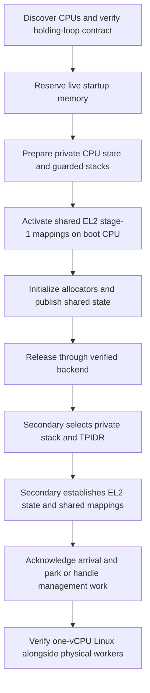

# Phase 11: tvisor physical SMP design

Status: initial design, 2026-10-25. No secondary CPU has been released by this
change. Architectural decisions below are proposed implementation contracts;
board startup details remain an explicit discovery milestone.

## Scope and starting checkpoint

Phase 11 brings Raspberry Pi 4 physical CPUs under tvisor's EL2 control while
Linux continues to see **one vCPU and 512 MiB of guest RAM**. Keep that vCPU on
the boot physical CPU throughout this phase. No guest `CPU_ON`, guest SGIs,
vCPU migration, scheduling across physical CPUs, or guest-DTB CPU expansion.
Those belong to Phase 12.

Phase 11 development starts from `main` at revision `0a5657e`, which merges
PR #26. The single-vCPU regression evidence was collected on its pre-merge
branch revision `bd639dc`, with the successful 2026-10-24/25 six-hour run:
11 boots, 76,832 wakeups, 288,321 memory passes,
360 independent console/IRQ checks, maximum wakeup lateness 52.001 ms and no
fatal markers. Evidence is in `guest/build/stability-run-2026-10-24/` when that
generated directory is available. See the [regression plan](phase10_stability_test_plan.md).
This establishes a useful baseline; it does not test SMP, fault isolation, or
guest teardown. Review existing exit/fault coverage before the release milestone.

The implementation sections below are ordered **11.0 through 11.6**. These
numbers are Phase 11 milestones, not separate chapter numbers. The scope,
shared decisions and audit apply to every milestone; the final summary lists
the validation gate for each one.

## Shared design decisions for Phase 11

| Area | Phase 11 decision |
|---|---|
| CPU ownership | tvisor owns physical-CPU lifecycle; `VmCtl` continues owning vCPUs |
| Identity | Dense logical IDs from validated DT MPIDR affinity; boot CPU is logical 0 |
| Per-CPU access | `TPIDR_EL2` points to a lifetime-stable, aligned `PcpuState` |
| Stacks | One 64 KiB EL2 stack plus an unmapped 4 KiB guard per supported CPU |
| EL2 stage 1 | Shared root and attributes; mappings frozen during initial bring-up |
| Guest stage 2 | Existing VM-owned tables; only boot CPU executes the guest |
| Startup | DT-selected, verified spin-table or PSCI backend; no guessed release address |
| Shared allocator | Serialize all bitmap access; remove the single-core `Sync` justification |
| Host UART | Boot CPU owns RX; serialize whole-message TX and guest output |
| Host interrupts | Per-CPU initialization; management SGI distinct from guest IRQ state |
| Failure | Bounded startup/handshake deadlines; never recycle a possibly live CPU's storage |

Initially bound capacity to four CPUs for the supported Pi 4 profile, but never
derive a logical index with `MPIDR & 3`. Reject duplicate affinities, an absent
boot CPU, unsupported enabled CPUs, or capacity exhaustion explicitly. Disabled
CPU nodes are recorded without release. Retain enough discovery evidence to
distinguish firmware-disabled from unsupported CPUs.

Proposed dependency order:



## Current code audit for Phase 11

| Current location | Required change before concurrent execution |
|---|---|
| `src/main.rs` assembly `main` | Secondary entry must bypass `.bss` clearing and U-Boot argc/argv parsing |
| `src/boot.rs` takeover path | Split once-only platform initialization from per-CPU EL2 initialization |
| `scripts/rpi.ld` | Replace the single stack layout with individually guarded stacks; validate the larger runtime footprint |
| `src/vcpu.rs::__pcpu_state` | Replace the global world-switch scratch block with per-CPU storage at all assembly access sites |
| `src/mm.rs::GlobalPageAllocator` | Bitmap `UnsafeCell` accesses currently rely on single-core/DAIF policy, not a lock |
| `src/mm.rs::TVISOR_TABLES` | Its mutex serializes writers but does not by itself make remote translations safe |
| `tvisor_util/heap_allocator.rs` | Existing mutex serializes heap metadata, but interrupt-side re-entry remains forbidden |
| `tvisor_util/debug_util.rs` | Atomic UART base does not serialize transmitted messages or RX FIFO consumers |
| `src/exception.rs` | Current-EL IRQ vector is fatal today; add EL2 management-IRQ dispatch before unmasking it |
| `tvisor_util/gicv2.rs` | Separate shared distributor setup from banked CPU-interface/SGI/PPI setup |
| `src/guest.rs` | Error paths still allocate `String`; they must not become general EL2 IRQ-handler paths |
| `tvisor_util/platform.rs`, `system_info.rs` | Add an owned CPU/startup description; memory discovery alone is not CPU discovery |

`spin::Once` publication can support immutable post-initialization data, but it
does not grant concurrent mutable access to the objects published through it.
Similarly, masking interrupts on one CPU does not exclude another CPU.

## 11.0: CPU discovery and startup contract

Before changing the release path, capture the live U-Boot DTB and board/build
evidence. This remains **pending**; successful normal Linux boot does not prove
that tvisor's `bootelf` handoff has the same secondary-CPU contract.

Record `/cpus` address-cell width, each enabled node's `reg`, `status`,
`enable-method`, and `cpu-release-addr` where applicable; record `/psci`
compatible/method if present. Correlate the boot MPIDR. Check U-Boot's exact
configuration/source, firmware startup path, actual release-cell contents,
secondary exception level, MMU/cache state, and coherency-domain requirements.
Do not infer a backend from the Pi model or from CONFIG_ARM_PSCI in Linux.

The standard spin-table convention uses a naturally aligned 64-bit
little-endian release cell, with publication/cache maintenance before an event
wakes the waiter. PSCI uses a different firmware CPU_ON protocol. These are
distinct contracts, described in the [AArch64 boot protocol](https://docs.kernel.org/arch/arm64/booting.html).
U-Boot also documents that spin-table implementations may use a common or
per-CPU release location; its generic documentation is not evidence of this
board's built behavior. See [U-Boot ARM64 notes](https://docs.u-boot.org/en/latest/arch/arm64.html).

### Explicit PSCI discovery and eligibility checks

Complete these checks in 11.0 without issuing `CPU_ON` or releasing a core:

1. Parse the PSCI node (normally `/psci`), its `compatible` and `method`, and
   each CPU's `enable-method`. Select the backend from the CPU description;
   the presence of a PSCI node alone does not select PSCI for every CPU.
2. Identify the advertised conduit, `smc` or `hvc`, and record the binding
   version. Reject missing, malformed or unsupported descriptions explicitly.
3. Establish that the conduit reaches the intended firmware service from
   tvisor's actual EL2 environment before executing a probe. Check firmware
   implementation/configuration and applicable trap controls. An EL1 HVC
   service is not automatically callable by its EL2 host; do not try arbitrary
   SMC/HVC instructions as a discovery strategy.
4. For a verified callable PSCI 0.2-or-later interface, query `PSCI_VERSION`,
   validate the returned version and retain the raw result. Legacy PSCI 0.1
   has no standard version query: report it separately and require an explicit
   implementation decision rather than using modern function IDs blindly.
5. Determine whether the AArch64 `CPU_ON` operation is available. For PSCI
   1.0 or later, query `PSCI_FEATURES` for `CPU_ON` using the intended SMC64
   function ID and validate the result. For PSCI 0.2, where `PSCI_FEATURES`
   is unavailable, use the mandatory `CPU_ON` contract of that version and
   verified firmware evidence. Legacy bindings require their advertised
   function IDs and a separately reviewed adapter. Never probe availability
   by actually calling `CPU_ON` in 11.0.
6. Verify the secondary entry contract from the applicable PSCI specification
   and firmware implementation: Non-secure AArch64 EL2 entry, MMU/cache state,
   coherency, entry-address constraints and context argument. Neither
   `PSCI_VERSION` nor `PSCI_FEATURES` reports the complete entry contract.
   Observe and validate the actual entry state during 11.3 bring-up before
   admitting the secondary to normal execution.

Report DT advertisement, EL2 conduit eligibility, version, `CPU_ON` capability
and entry-contract evidence as separate results, including unknown/unsupported
states. A failed PSCI check does not authorize automatic spin-table fallback;
that backend needs its own DT description and verified startup contract.
The [Arm PSCI specification](https://documentation-service.arm.com/static/640f584656ea36189d4e94a4)
and [Linux PSCI binding](https://android.googlesource.com/kernel/common/+/4427259cc7f7571a157fbc9b5011e1ef6fe0a4a8/Documentation/devicetree/bindings/arm/psci.yaml)
provide the interface and discovery references.

### Parking-memory ownership is a prerequisite

The present takeover policy permits reclaiming U-Boot RAM. A secondary may
still execute a U-Boot/firmware holding loop, use its translation tables, or
poll a release cell in that memory. Whether this happens on lab-rpi4 is not yet
established. Treat it as an ownership hazard requiring evidence, not as proof
that the existing single-core baseline is corrupt.

Discover and reserve the complete live startup dependency footprint **before
allocator initialization**, guest allocation, or any release-cell write. Include
holding-loop code/data, stacks/tables if used, and release-cell pages. A DT cell
address alone does not describe that complete footprint. If its extent cannot
be established, defer reclamation of a conservatively established U-Boot runtime
reservation or reject SMP startup; never invent bounds from an old `bdinfo`.

For the initial implementation, keep these extra reservations permanent for the
run. Later reclamation requires acknowledgement that every affected CPU has
left the old code and a separate reservation-lifetime design. This avoids making
first secondary entry depend on new allocator reclamation machinery.

### Backend behavior

- Spin-table: validate cell range/alignment and memory ownership; publish the
  entry code and mailbox state to the required coherency point, write the entry
  PA as little-endian, complete required barriers/cache maintenance, then `SEV`.
  Volatile access alone is not the publication protocol.
- A shared release cell may make several CPUs enter the trampoline. Route them
  by MPIDR into tvisor-owned holding pens; only requested targets advance to the
  online milestone. Do not claim that one release write necessarily wakes only
  one physical CPU. This behavior must be demonstrated before using that backend.
- PSCI: first verify that the firmware service and conduit are callable from
  tvisor at EL2 and return a secondary at the required EL. Implement checked
  CPU_ON results/timeouts. Do not expose this service to the guest. An HVC
  conduit intended for an EL1 caller is not automatically usable at EL2.
- Unsupported or ambiguous methods fail closed. Do not fall back to guessed
  firmware mailboxes or assume an EL1 entry can promote itself to EL2.

All CPUs that can reach the trampoline must have valid startup records and
reserved storage, including unrequested CPUs woken by a shared release cell.

## 11.1: Per-CPU structures and guarded stacks

Add `src/pcpu.rs` for storage/access and `src/smp.rs` for lifecycle orchestration.
Add a pure `tvisor_util/cpu_topology.rs` model/parser support for host tests.
Illustrative structures (final names/layout determined with assembly changes):

```rust,ignore
struct CpuDescriptor {
    logical_id: CpuId,
    mpidr_affinity: u64,
    startup: CpuStartupMethod,
}

#[repr(C, align(64))]
struct PcpuState {
    host_sp: u64,
    active_vcpu: *mut Vcpu,
    // CPU identity, stack limits, diagnostic/exception state, local GIC target.
}
```

Keep atomic lifecycle/mailbox fields separate from owner-only mutable context.
Do not make raw-pointer state `Sync` by assertion without specifying who can
access each field. Only the owning CPU mutates its `host_sp`, current exception
state and `active_vcpu`; cross-CPU commands use atomics/mailboxes.

Define the lifecycle and mailbox layout in 11.1; secondary release and arrival
transitions are implemented and validated in 11.3. Management requests follow
in 11.4.

Proposed states:

```text
Discovered -> Prepared -> ReleaseRequested -> Entered -> Online -> Parked
                                  |                       ^         |
                                  +-> Failed              +---------+
```

`Entered` confirms the trampoline has captured its affinity and private storage;
`Online` confirms shared EL2 mappings, local state, and the selected interrupt
milestone are established. `Parked` means tvisor-owned and available for a bounded
management request, not power-gated. Do not add physical CPU_OFF/hotplug yet.

Use release/acquire publication for immutable startup records and state changes;
waiters recheck predicates after WFE and use SEV to notify after publication.
Every boot attempt carries a generation/token so a late CPU cannot acknowledge
a newer attempt. A timeout does not prove the CPU stopped executing. On failure,
keep its storage and reservations, prohibit normal SMP continuation, preserve
diagnostics and reset before retrying.

`TPIDR_EL2` points to that CPU's stable descriptor once its stack is selected.
Change every `__pcpu_state` reference in world-switch/exit assembly to this
lookup, and initialize boot-CPU TPIDR before any path can enter a guest. Keep
compile-time offset assertions. Verify `active_vcpu == null` on worker CPUs;
the VM-owned vCPU remains bound to logical CPU 0 throughout Phase 11.

### Guarded stacks and shared EL2 mappings

Provision four 64 KiB stacks, each preceded by a 4 KiB unmapped guard, inside
the linker-owned runtime footprint. Preserve 16-byte SP alignment. The 272 KiB
stack/guard total replaces the old one-stack budget; assert section extents and
test every guard's software translation. Do not assume the existing sixteen
table pages remain sufficient after mappings change; calculate and validate the
arena requirement. Recheck ELF source/runtime, guest staging, DTB and U-Boot
non-overlap on the board after linker changes.

## 11.2: Synchronization and logging

Provide a small IRQ-save spinlock wrapper: save local interrupt state, mask
local IRQ while acquiring/holding an interrupt-shared lock, release the lock,
then restore the exact prior state. Never unmask interrupts merely because a
guard drops. Use acquire/release lock semantics across CPUs. Host-test state
restoration and lock ownership independently of AArch64 instructions.

Initial rules:

- One lock covers physical allocator initialization, bitmap mutation and stats.
  Create mutable bitmap views only while locked; no guard/reference escapes.
- Finish heap and static publication before releasing workers. Keep the existing
  heap mutex for thread-side operations; forbid allocation in EL2 IRQ/exception
  handlers. Replace allocating diagnostic/error paths before using them there.
- No allocation, UART output, callbacks, or hardware waits while holding allocator
  or page-table locks. Workers report errors after releasing those locks.
- Initially avoid nesting shared-resource locks. If later necessary, document a
  total order and test it; do not improvise one in an interrupt handler.
- UART TX serializes a complete formatted message. The guest byte-output path
  participates in the same serialization policy; boot CPU remains the only RX
  FIFO consumer. Worker IRQ handlers record counters, not formatted output.
- Panic/early-fault output uses bounded try-lock/emergency records, never waits
  forever for a UART lock that might be held by the faulting CPU. A shared fatal
  flag and per-CPU failure records preserve evidence without allocating.
- VM and vCPU objects remain exclusively boot-CPU-owned. This avoids adding a
  speculative VM scheduler lock while introducing physical SMP.

Audit bounded critical-section lengths so allocator/logging tests do not starve
the guest timer or UART. Sharing a CPU-safe heap does not make all `alloc` calls
safe in an interrupt context.

## 11.3: Secondary entry and tvisor-owned holding loops

The secondary assembly entry must:

1. Mask DAIF, read CurrentEL and MPIDR, and locate a bounded immutable record
   without stack or Rust. Reject unsupported EL/affinity without touching shared
   state. Backend adapters establish a documented MMU/cache entry contract.
2. Select only its private stack, SPSel, TPIDR and exception-vector base. Never
   clear `.bss`, parse U-Boot argv, or run global/heap initialization again.
3. Establish all required EL2 control, trap, FP/SIMD, timer and cache/coherency
   state before compiler-generated Rust can depend on it. Share common policy
   with the primary; do not copy another CPU's per-CPU context or blindly reuse
   unknown SCTLR state.
4. Join the shared EL2 stage-1 root with identical MAIR/TCR/attributes, required
   descriptor/code publication, local invalidation and instruction barriers.
   The early trampoline, records and stack must be accessible on both sides
   of the MMU transition. Guard protection begins after tvisor's mappings apply.
5. Complete the startup synchronization described below and cross the explicit
   Rust entry boundary. Only then call `secondary_main()` to validate local
   state, initialize remaining per-CPU services and publish the bounded arrival
   acknowledgement. Enter a tvisor-owned management/parking loop; enable no
   guest execution. Keep IRQs masked until 11.4's handler-readiness gate.

### Boundary for ordinary shared Rust data access

`secondary_main()` is the first Rust entry point on a secondary. Before calling
it, the assembly/backend path must establish all of these conditions:

- The CPU has a validated identity, an exclusively owned ABI-aligned stack and
  initialized TPIDR/vector state. The required EL2 controls and compiler execution
  environment, including FP/SIMD policy, are ready.
- The shared EL2 stage-1 mappings are active locally with compatible memory
  types, cacheability and shareability. Required code/table publication, local
  TLB maintenance and architectural completion/instruction barriers are complete.
- Firmware/backend evidence establishes membership in the required coherency
  domain before shared synchronization is used. Enabling translations, executing
  an ISB or performing an acquire load does not establish that membership.
- The boot CPU has completed once-only initialization of every shared object
  exposed to this entry point, then release-published a startup-ready token.
  The secondary has acquire-observed the matching generation/token through the
  verified coherent startup mailbox. Assembly implements this handoff with
  semantics compatible with the Rust atomic protocol; volatile reads do not
  substitute for acquire/release synchronization.

```text
Validated backend entry and coherency contract
    -> Read CurrentEL / MPIDR_EL1
    -> Select private stack, TPIDR and vectors
    -> Configure required EL2 execution state
    -> Enable shared EL2 stage-1 mappings and complete maintenance/barriers
    -> Acquire-observe the boot CPU's published startup-ready token
    -> [ordinary shared Rust access is now permitted under ownership/lock rules]
    -> Rust secondary_main()
```

Before this boundary, access only the explicitly described startup memory:
entry code, bounded immutable CPU records, the selected private stack/context,
translation tables and the dedicated startup mailbox. Each must have a documented
addressing, ownership and publication/cache-maintenance contract for the entry
regime, including the MMU transition. Early record reads are not permission to
access arbitrary Rust objects. Do not call Rust helpers, allocators, formatting,
logging, locks or general shared globals on this path. Failures use a bounded
assembly park path without those services.

Crossing the boundary permits access; it does not grant unrestricted mutable
access. Immutable objects must be fully published, CPU-local objects remain
owner-only, and shared mutable objects still require their specified locks or
atomics. Any service not initialized by this point remains unavailable until
its own readiness gate. In particular, entering Rust is distinct from `Online`:
local GIC/management readiness and the arrival protocol must still be completed.

Review the entry disassembly to verify that no Rust call precedes the boundary.
Test the startup-ready protocol's matching-generation and acquire/release rules
on the host, and record a checkpoint immediately after entry on hardware using
only services whose readiness has been established.

For initial backend bring-up, require an established EL2, MMU-off physical entry
contract, or an explicitly reviewed adapter that reaches it safely. Do not
silently reuse the BSP's inherited-translation transition for unknown secondary
state. Coherency-domain membership is a release prerequisite, not something an
acquire load or an ISB can create.

Freeze EL2 mappings before initial release. A worker must not access MMIO until
its own translations are active; the earlier GICD_TYPER fault demonstrates why
constructing another CPU's tables is insufficient. Guest stage-2 activation is
still boot-CPU-local. Stage-2 tables must not be freed while any CPU can execute
their VM; migration and VMID reuse across CPUs are deferred to Phase 12.

## 11.4: GICv2 and management interrupts

Split distributor-wide SPI setup (boot CPU once) from per-CPU banked SGI/PPI and
CPU-interface setup. Validate MMIO mappings first on each CPU. Discover each
CPU's actual GIC target-interface mask; do not assume it equals `1 << logical_id`.
Route the physical Mini UART SPI only to the boot CPU and keep the guest virtual
timer/GICH state local to the CPU running the vCPU. Unused worker timers stay
disabled; adding management ticks requires its own documented timer policy.

Reserve a physical management SGI, proposed INTID 1, after checking firmware and
interrupt-group ownership. Add GICD_SGIR support and request/ack mailboxes for
ping, bounded worker tests, park and fatal-stop notifications. EL2 cannot assume
it can reclassify secure interrupts through a Non-secure GICD_IGROUPR view.
Verify a usable Non-secure SGI contract before unmasking management IRQs.

The current `acknowledge()` masks GICC_IAR down to INTID. For SGIs, retain the
full acknowledgement token (including source CPU information) for EOI/DIR,
while exposing INTID separately for dispatch. Complete host-owned interrupts
according to the configured split EOI/deactivation mode; a management SGI is
not a hardware-backed guest timer List Register and must not use its completion
path. Continue rejecting special IDs from normal completion paths.

Handle current-EL IRQs on worker EL2 stacks and lower-EL IRQ exits on the boot
CPU. Both dispatch host management requests without injecting them into Linux.
Do not enable IRQs on a worker until its per-CPU vectors/state and handler are
ready. Prove IPI completion/acknowledgement before attempting TLB work.

### Management SGIs while CPU0 executes Linux

Treat guest execution on CPU0 as an explicit management-interrupt case, not
just worker-to-worker delivery. Verify the complete physical path: SGI group
ownership, target mask, distributor/CPU-interface enables, priority threshold
and preemption configuration, plus the firmware's EL3 routing contract.

For the intended Non-secure physical IRQ delivery, verify effective
`HCR_EL2.IMO = 1` during guest execution so physical IRQs target EL2, subject to
higher-level routing. Audit `FMO` and `AMO` against the separate FIQ/SError
policy, and verify the intended non-VHE `TGE = 0` configuration; do not set TGE
as a shortcut for management delivery. Check every guest-entry, exit and
stage-2 activation/deactivation path so rewriting HCR does not drop required
routing controls. Record/read back relevant controls at validation checkpoints.
Review effective routing and masking rules against the
[Arm virtualization guide](https://developer.arm.com/-/media/Arm%20Developer%20Community/PDF/Learn%20the%20Architecture/Armv8-A%20virtualization.pdf).

A management SGI received while Linux executes must enter the lower-EL IRQ
vector, preserve the interrupted vCPU context, and dispatch to a host-owned
handler before any generic guest-injection logic. Process the request and
complete the full physical acknowledgement token using the configured EOI/DIR
policy. Resume the interrupted guest with its architectural and virtual GIC
state preserved. Never create a GICH list-register entry, set `HCR_EL2.VI/VF`,
or mark a guest interrupt pending because of a management SGI. Existing guest
interrupt delivery remains a separate path.

The 11.4 hardware gate must include worker-to-CPU0 requests while Linux is
actively running and while it is idle/WFI, alongside guest timer and UART
traffic. Require bounded acknowledgements, host-only SGI counters, no management
SGI injection events, correct physical completion, and continued guest progress.
Also test CPU0 handling while it executes at EL2: pending requests during
bounded masked regions must be serviced once the established handler/masking
policy permits. Include guest IRQ-masked execution to verify routing does not
depend on Linux unmasking its virtual IRQs. Use host instrumentation to prove
non-injection; absence from Linux's interrupt listing alone is insufficient.

## 11.5: All-core bring-up and concurrent resource tests

Use the verified startup path and management requests to bring all eligible
physical CPUs online. Validate distinct MPIDR affinities, stacks, TPIDR values
and GIC target masks. Keep the guest's single vCPU on the boot CPU.

Run bounded worker allocation/free, heap and serialized logging tests. Check
that no two live allocations own the same physical page, and quiesce workers
before comparing resource statistics. Exercise management requests while
workers run, and verify timeout diagnostics without recycling a possibly live
CPU's storage. This milestone validates concurrent execution with the shared
EL2 mappings still frozen; mapping updates belong to 11.6.

## 11.6: Mapping changes, TLB synchronization and final regression

An EL2-table mutex is necessary for writers but insufficient for CPUs using old
translations. Keep maps immutable until this protocol has its own milestone.
For a later mapping update:

1. Serialize the update; coordinate affected CPUs so none can use/reuse the old
   mapping or resource while it changes. Membership includes parked CPUs that
   retain the translation regime; changing membership is serialized too.
2. Apply architecturally required break-before-make and descriptor publication.
   Use the correct EL2 inner-shareable TLBI (initially a broad `ALLE2IS` is
   acceptable), completion barriers and local instruction synchronization.
3. Use sequence-numbered management requests/acknowledgements where software
   quiescence is needed. Do not conflate an SGI acknowledgement with completion
   of architectural broadcast TLBI; audit both contracts separately.
4. Do not free/reuse old backing or table pages until hardware invalidation and
   required software acknowledgements are complete. A timeout is fatal to that
   update; do not continue with partially synchronized mappings.

Validate instruction/TLB/cache-maintenance sequences against the applicable Arm
architecture manual during implementation. Exercise remapping only in a reserved
scratch region, not the running kernel, its stack, vectors, or a guest page.
Guest stage-2 cross-CPU execution and its associated shootdowns remain Phase 12.

## Phase 11 milestone summary and validation gates

| Step | Deliverable | Gate before proceeding |
|---|---|---|
| 11.0 | Owned topology and verified startup/memory contract | Host malformed-DT tests; explicit PSCI conduit/version/CPU_ON/entry-contract report; captured U-Boot/DT/firmware evidence; parking dependencies reserved before allocation |
| 11.1 | Boot CPU uses per-CPU storage and guarded stack layout | Assembly offsets/disassembly checked; single-core quick regression passes, no secondary release |
| 11.2 | Allocator/UART locking and interrupt-safe boundaries | Host contention/ownership tests; no unsynchronized mutable statics or allocating IRQ paths used by SMP |
| 11.3 | Secondary trampoline and tvisor-owned holding pens | One requested secondary reaches validated private EL2/park; shared-cell behavior accounted for; bounded failure test |
| 11.4 | Host SGI request/ack dispatch | Per-CPU IRQ routing and raw-token completion demonstrated, including CPU0 guest execution/WFI; no management injection or lost requests/deadlocks |
| 11.5 | All eligible CPUs and concurrency tests | Unique affinities/stacks/TPIDR/GIC targets; concurrent allocation/free has no duplicate live pages; heap/logging remain consistent |
| 11.6 | TLB/update protocol and final physical SMP gate | Reserved scratch remapping and barrier/shootdown tests pass; parked workers coexist with the one-vCPU overnight regression |

Host tests cover topology ordering/duplicates/capacity, backend validation,
mailbox publication/state transitions/generations, timeout handling, guard-map
layout and allocator exclusion, concurrent allocator ownership, exact IRQ-state
restoration, and simulated membership/shootdown acknowledgement. Hardware tests
remain necessary for exception levels, coherency, banked GIC state, atomics,
barriers and TLB behavior; host simulations do not validate those instructions.

Add explicit checkpoints with logical ID, MPIDR, CurrentEL, SP, TPIDR and root PA.
Do not assert exact heap/page counts while worker allocations are in flight;
join/quiesce workers before comparing teardown statistics. Test that a late or
unresponsive CPU is reported without reusing its stack or releasing its memory.

Keep the existing single-vCPU regression as the comparison baseline. Extend its
runner with an explicit physical-SMP mode only after the implementation exports
verifiable CPU-online/park counters. Running the unchanged single-vCPU suite
does not prove workers were online. At the final gate, demonstrate all eligible
cores, then park workers and repeat the six-hour guest test; add bounded worker
allocation/IPI bursts during a separate guest run to test actual concurrency.
Keep guest DT CPU count one throughout. Preserve artifacts and power off the
board after tests. Do not combine first secondary release and first guest SMP.

## First implementation change: 11.0

Begin with 11.0: add allocation-free CPU discovery and a report of the startup
contract, plus host tests. Capture the lab board's working DTB and U-Boot startup
configuration without releasing a core. Resolve the holding-memory reservations
before changing allocator policy. This makes the first SMP-specific PR reviewable
and leaves today's tested boot behavior intact.

Open evidence items: actual enabled-CPU topology, per-CPU/common release cells,
holding-loop physical footprint, EL/MMU/cache entry state, usable firmware
conduit, GIC target masks/management-SGI group, and shared-table arena capacity.
None is assumed resolved merely by this design document.
